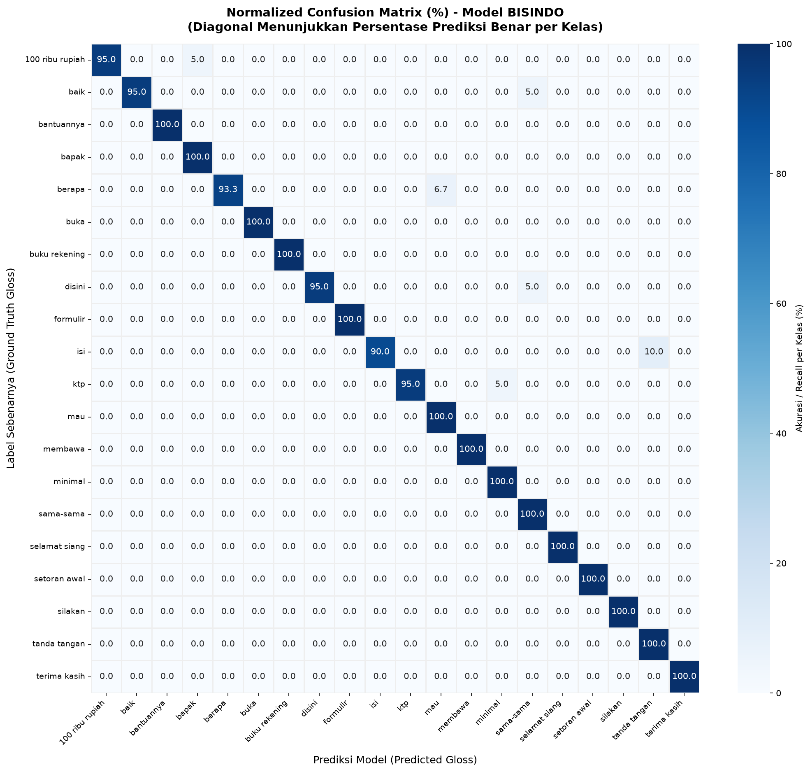
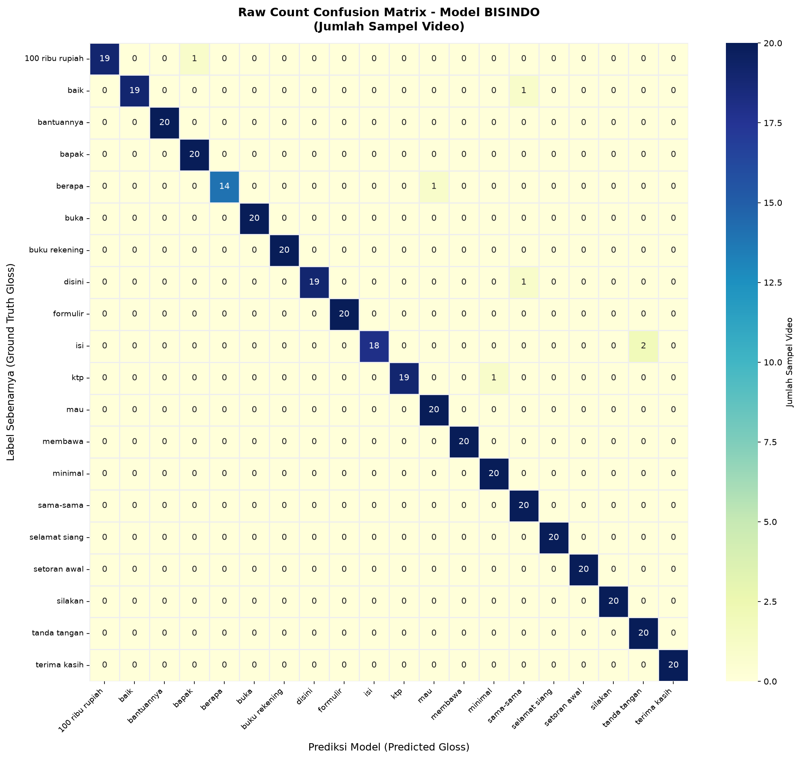
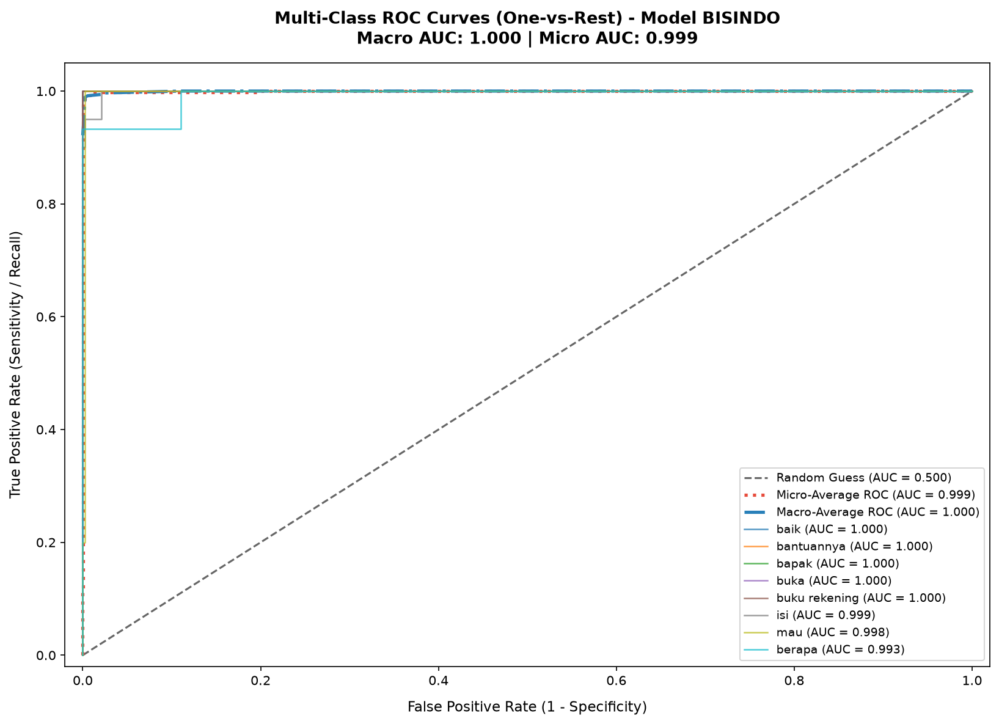
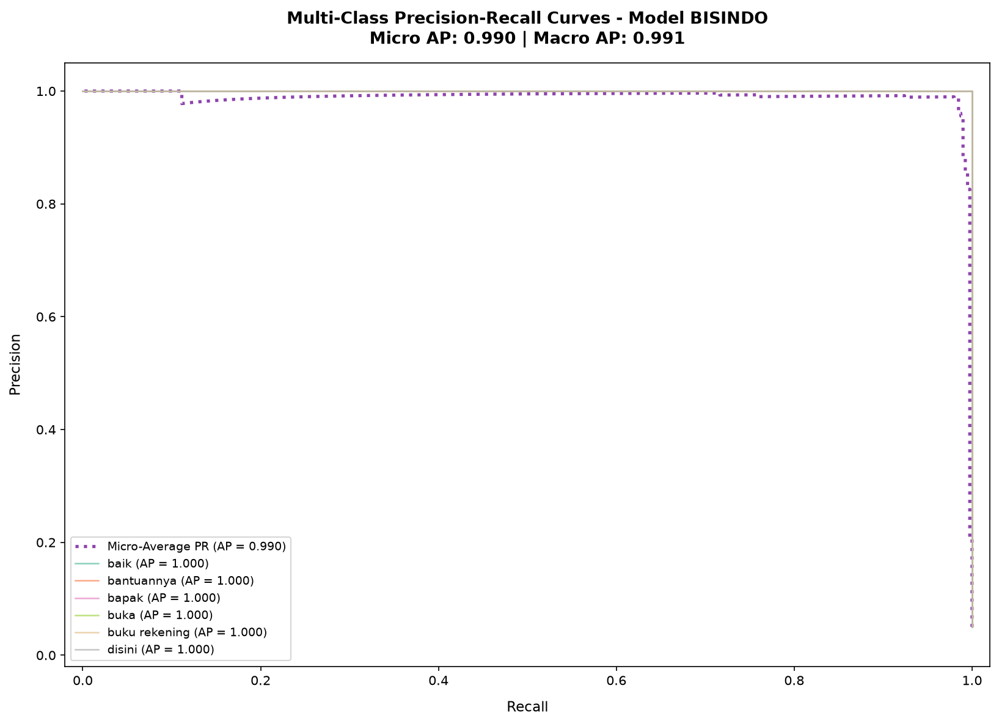
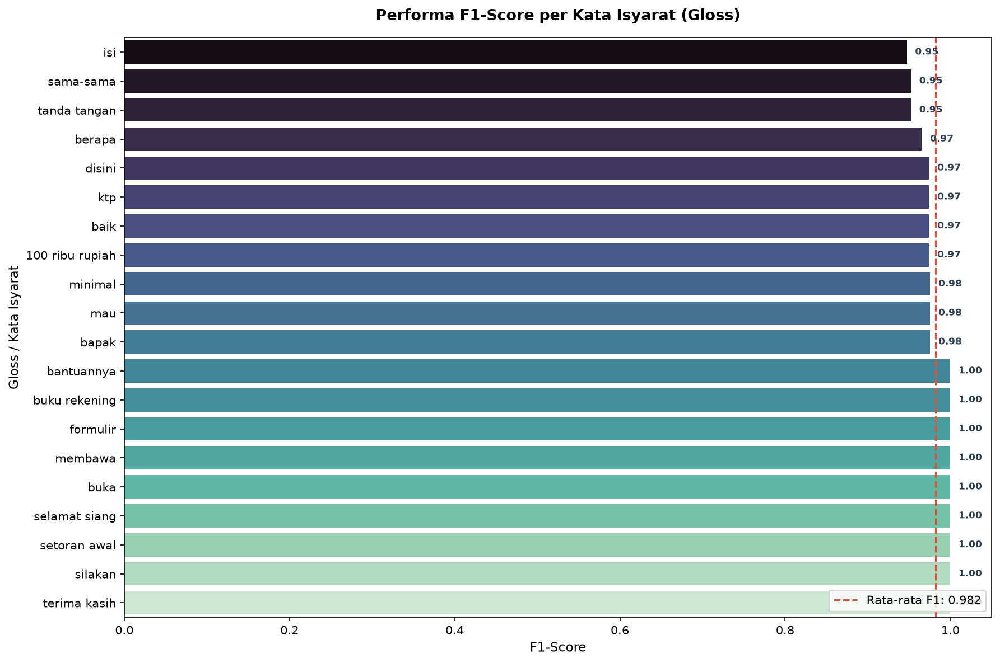
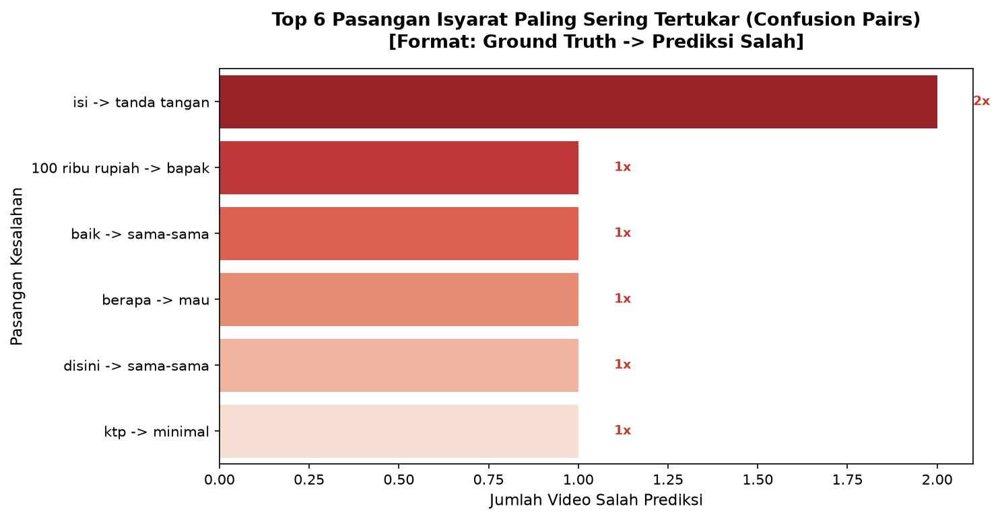

# Laporan Hasil Evaluasi Model Isyarat BISINDO

> **Tanggal Evaluasi**: 2026-10-17 21:43:59
> **Model**: `models/manual_lstm_best.pt` (Arsitektur: MGN, Input Dim: 400)
> **Data Evaluasi**: `Semua Signer (395 video)` (Total Sampel Video: 395, Kelas: 20)

## 1. Ringkasan Metrik Utama (Executive Summary)

| Metrik | Nilai | Keterangan |
| :--- | :---: | :--- |
| **Video Consensus Accuracy (Top-1)** | **98.23%** | 1 Video = 1 Keputusan Konsensus |
| **Top-3 Accuracy** | **99.75%** | Label benar masuk 3 probabilitas tertinggi |
| **Top-5 Accuracy** | **99.75%** | Label benar masuk 5 probabilitas tertinggi |
| **Macro F1-Score** | 0.9821 | Rata-rata F1 seluruh kelas tanpa bobot |
| **Weighted F1-Score** | 0.9823 | Rata-rata F1 berbobot proporsi sampel |
| **ROC Macro AUC** | 0.9996 | Kemampuan separasi kurva ROC makro |
| **ROC Micro AUC** | 0.9992 | Kemampuan separasi kurva ROC mikro |
| **PR Micro AP** | 0.9896 | Average Precision pada kurva Precision-Recall |

## 2. Visualisasi Evaluasi (Charts & Curves)

### Normalized Confusion Matrix (%)

### Raw Count Confusion Matrix

### Multi-Class ROC Curves (One-vs-Rest)

### Precision-Recall (PR) Curves

### Performa F1-Score per Kelas Isyarat

### Top Confused Pairs (Pasangan Isyarat Tertukar)

## 3. Analisis & Insight

- **Akurasi Konsensus vs Window**: Menggunakan pooling temporal konsensus seluruh frame video menghasilkan akurasi yang lebih tinggi dan stabil dibandingkan keputusan per frame window terisolasi.
- **Karakteristik Confusion Matrix**: Gerakan isyarat yang memiliki titik orientasi serupa (misal isyarat berbasis waktu seperti Pagi/Siang/Sore/Malam, atau warna Merah/Kuning/Hijau) memiliki tingkat kebingungan lebih tinggi jika hanya mengandalkan koordinat posisi. Fitur *Instantaneous Velocity* $\Delta P_t$ dan *Relational Distance* membantu membedakan arah gerakan tersebut.
- **Distribusi Signer**: Evaluasi pada holdout Signer 3 merefleksikan kemampuan generalisasi model pada pengguna baru (*unseen signer*).
